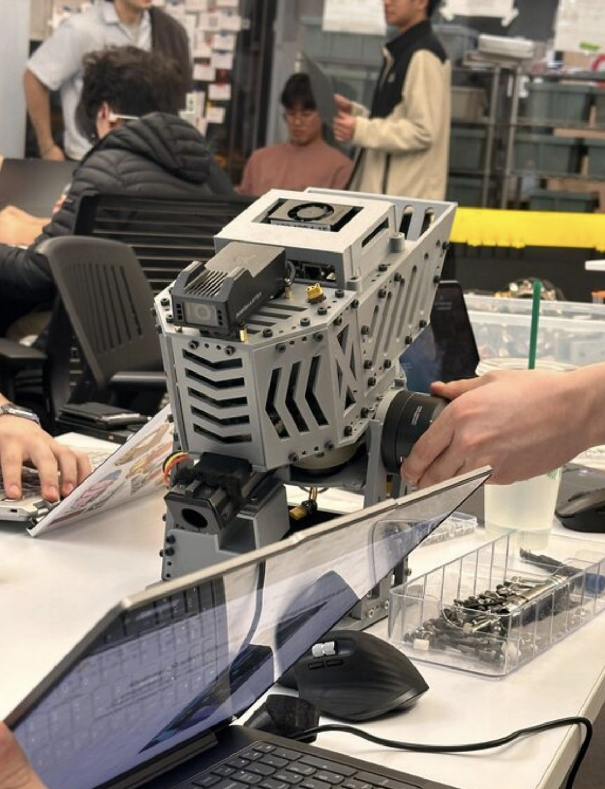
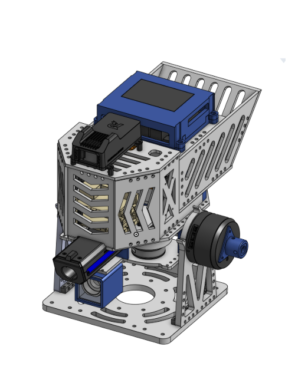
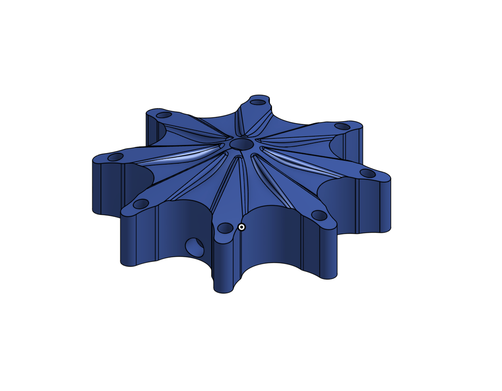
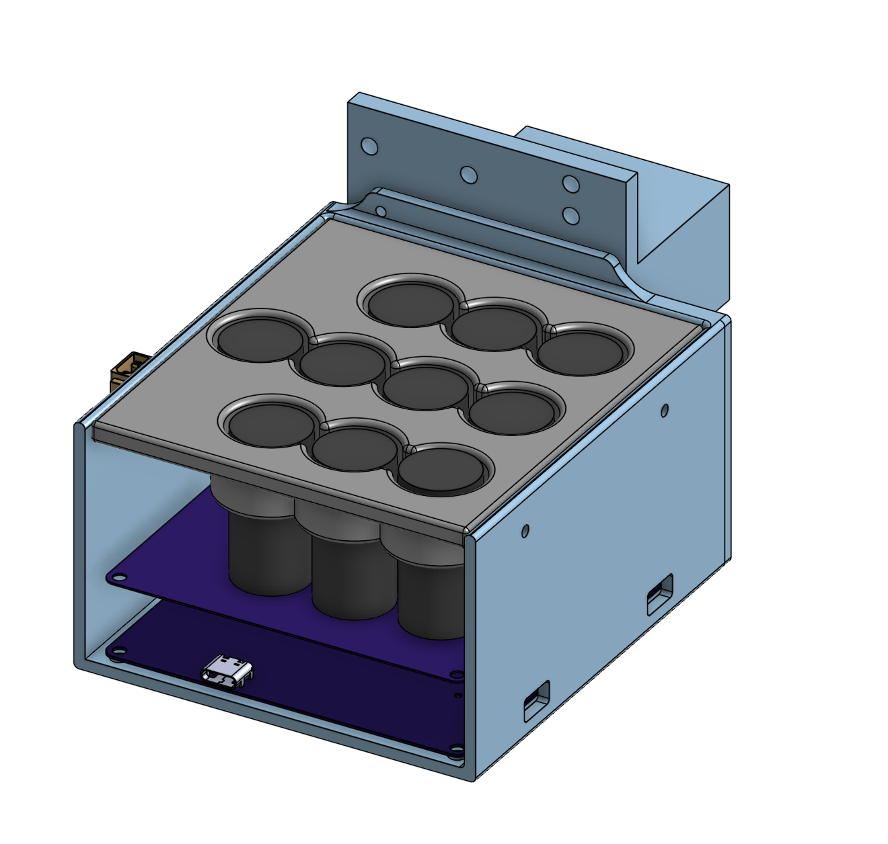

# RoboMaster gimbal packaging

Packaged a nominal 78.0 mm PLA ball-feeder wheel with front armor and a supercapacitor shell, and replaced press-fit-only retention with an M3 fastener. The retained record reports a limited 500 RPM check; the approximately 20.5 mm feed envelope is a design-record dimension, not a verified minimum running clearance.

## My contribution

Ball-feeder wheel CAD, supercapacitor enclosure shell, front armor packaging, feed-path review, M3 retention revision, and support for the reported 500 RPM prototype check.

## Design decisions

- Packaged the printed ball-feeder wheel, supercapacitor shell and front armor around the existing gimbal. The wheel feeds balls into the launcher; it is not the projectile launch flywheel.
- Replaced press-fit-only wheel retention with an M3 fastener.
- Supported the reported 500 RPM prototype check. No measured speed trace, duration, repeat count or feed-event log is retained, so this observation establishes no throughput, jam rate, speed regulation or retention endurance.

This is my historical subsystem contribution to NYU RoboMaster UltraViolet; the full team gimbal is shown for integration context. The historical robot generation and ball dimensions remain unverified. My current Hero design/build/test role is separate and remains active.

## CAD and build record

[Full case study](https://www.mergenulziibayar.com/projects/robomaster-launcher) · [Engineering report](https://www.mergenulziibayar.com/downloads/reports/robomaster-launcher.pdf) · [Portfolio](https://www.mergenulziibayar.com)

## Record scope

This repository publishes the existing project photographs and CAD renders. [Image sources and hashes](sources.json) preserve their provenance. CAD renders are illustrations of the design record; native CAD files are not included. No new experiment was performed for this publication.
